# Tilli Measures — Teacher dashboard updates

Changes to the teacher side of Tilli Measures for this build. Each item includes the relevant screenshot. "Blue version" = the current / live dashboard.

> Keep this `.md` in the same folder as the screenshot PNGs so the image links resolve.

---

**The first-time setup.** The first time a teacher signs in, they complete a one-time setup that unlocks their dashboard. Today this runs as a separate assessment; it should instead live inside the dashboard onboarding itself, not as a standalone assessment. It has two parts: a short demographic step ("Tell us about yourself" — name, email, gender, age, years in teaching, highest education level) and a ten-question pre-training reflection on a 1–5 scale (Strongly disagree → Strongly agree), grouped into Mindsets, SEL Competencies, Practices, Climate, and Wellbeing. It appears only once, the first time a teacher arrives. The questions should be pulled from what we already have, and kept editable, so Masoomi or Ishani can change them without a rebuild.

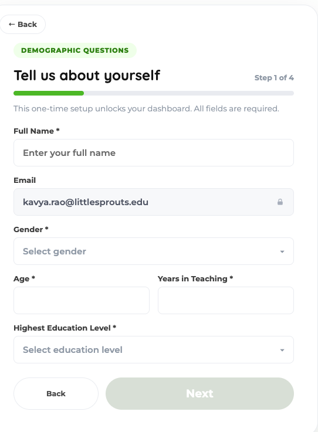

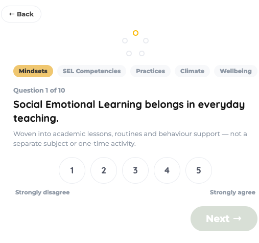

---

**Adding students (during onboarding).** On the "Add your students" step, the grade and section should be set once for the whole group rather than chosen on every student row — students then sit grouped under their section, and the teacher sees each section's students listed. Removing the per-row grade·section picker also fixes a current problem: that dropdown takes up so much width that the first name, last name, and admission number are cut off to single letters. With it gone, the full name and admission number should be visible.

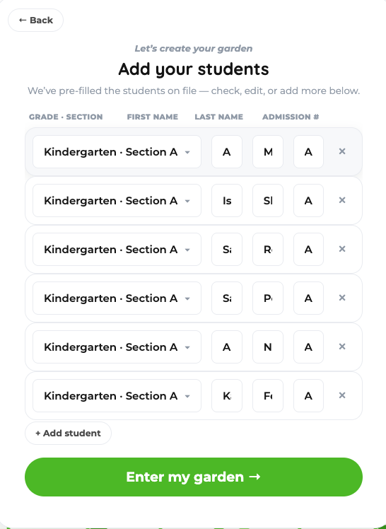

---

**Adding students later.** Teachers should also be able to add students from inside the dashboard — not only during the first-time setup.

---

**The landing-state switcher.** The "Landing State" switcher (Baseline / Between / Midline / Endline) is useful for testing how each state looks. How it's surfaced for review is Mayur's call.

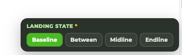

---

**Recording observations.** In the Assess → Enter flow, once a teacher finishes recording one student's observation, they should move straight to the next student who still has a pending assessment, and keep going until none are left.

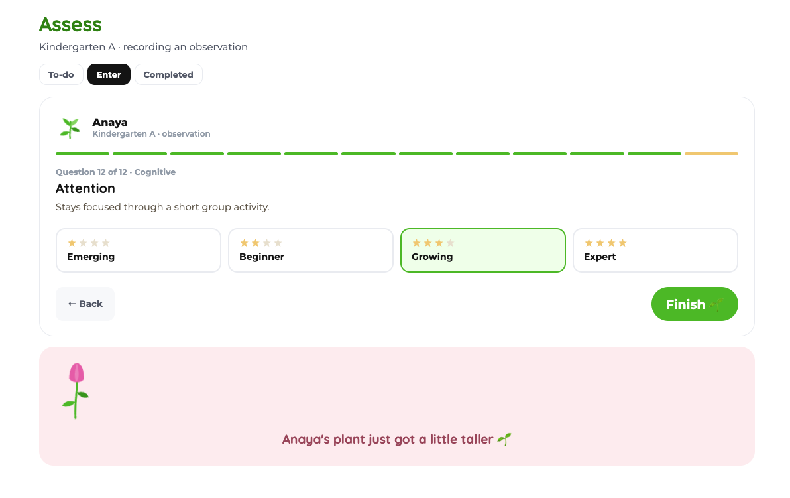

---

**Insights.** For now, the Insights page should show what the current (blue) version shows as its overview, rather than the empty "insights arrive after baseline" state. (To confirm.)

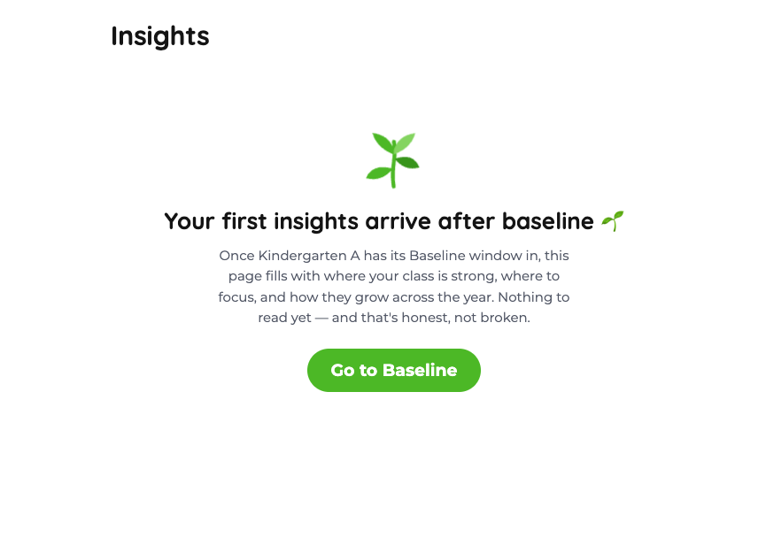

---

**The student profile.** The parent verification code no longer exists and should be removed from this screen. In its place, each student should show their student UID (unique code). The assessment-data section should display exactly as it does in the current (blue) version.

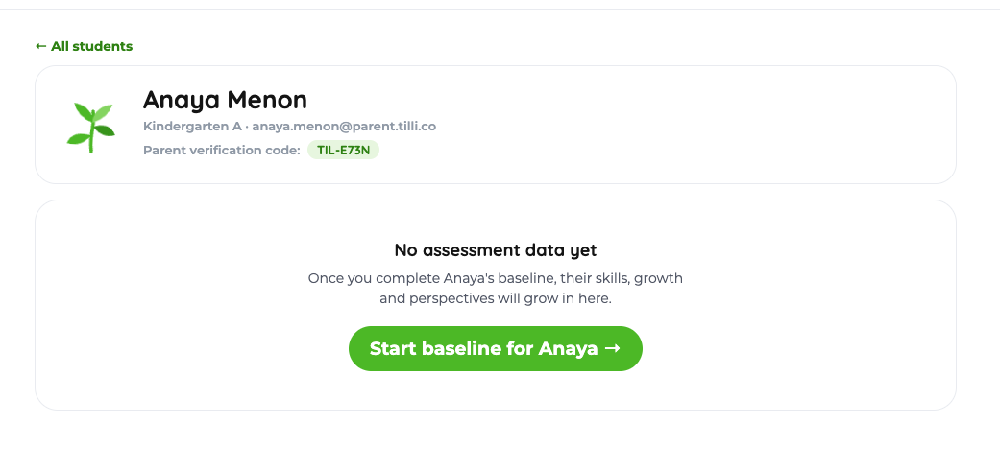

---

**The students list.** Each student's UID should also be visible here, alongside their name — not only on the student's profile.

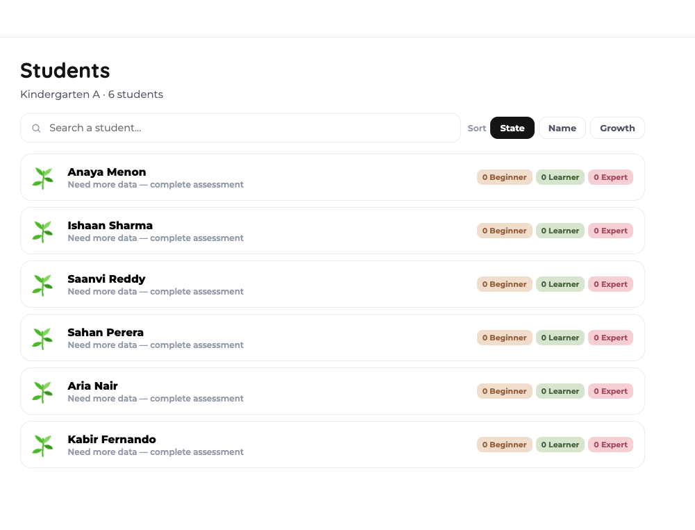

---

**The teacher's profile.** The profile should also show the teacher's Teaching Mirror, the grades they teach, and the date they joined Tilli Measures — and the teacher should be able to edit their details.

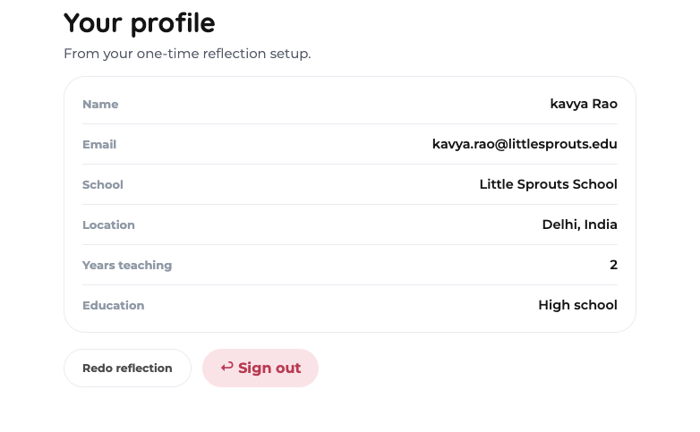

---

**Sharing reports with parents.** From the students list, a teacher should be able to select several students at once and download a PDF for each one, ready to share with that child's parent. (An example PDF will follow — match its format.)

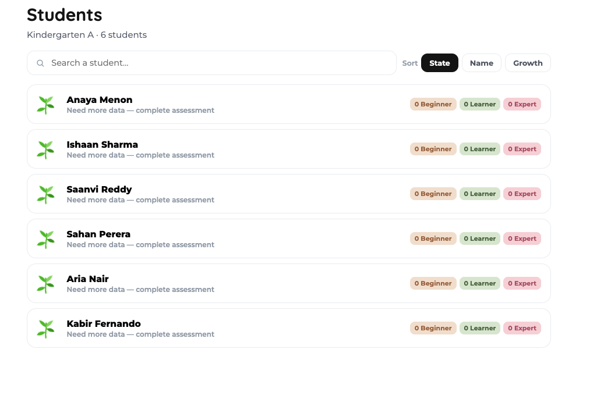

---

**The assessment overview.** When only one window is active — only baseline, or only midline, or only endline — the overview should show just that window rather than all three. In that single-window view, each student's completion is shown by informant, in columns for Teacher, Parent (Home), and Student (for example, Teacher 0/1, Parent 0/2, Student 3/5), with a tick when a part is complete. This screen should also offer a Download CSV option that exports the whole assessment log. (A sample CSV will follow — match its format.)

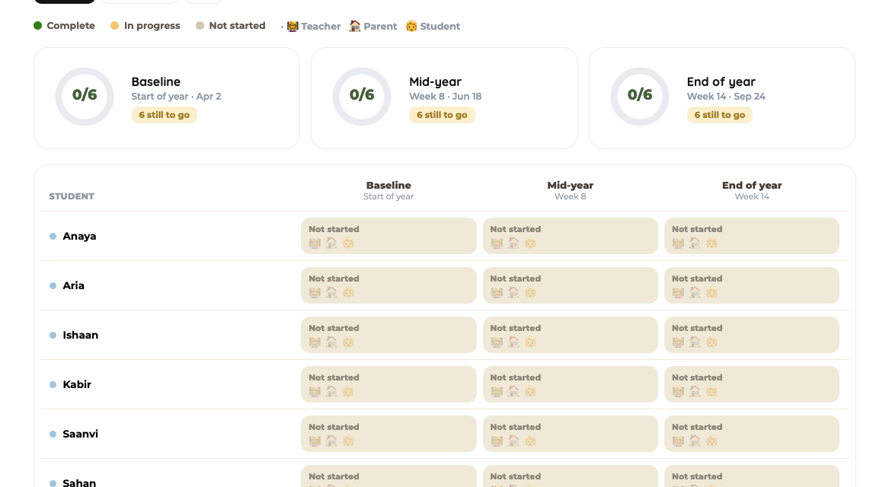

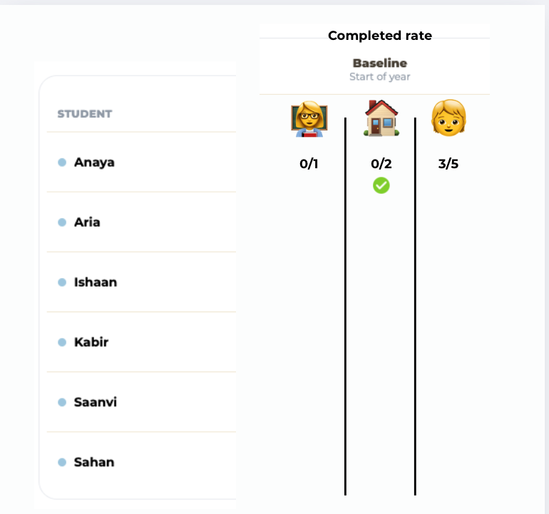

---

**Previewing states.** The state-change options (Baseline / Between / Midline / Endline) should be available on every page, so any page can be previewed in each state.

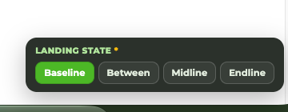
